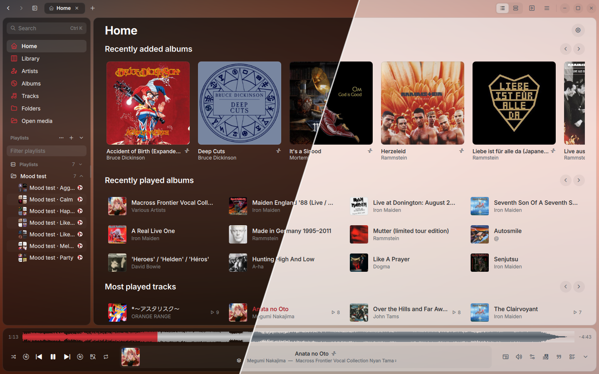
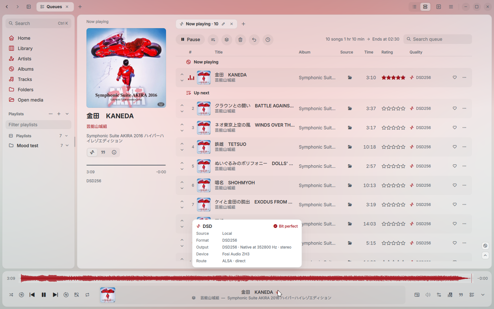
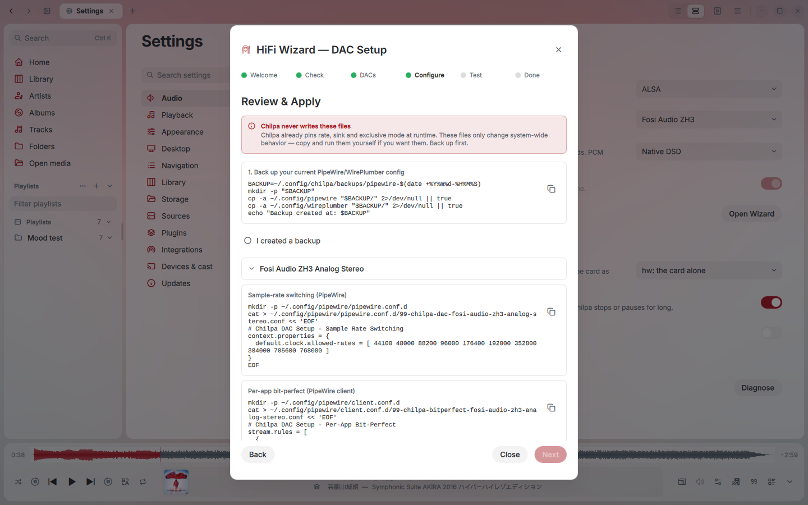
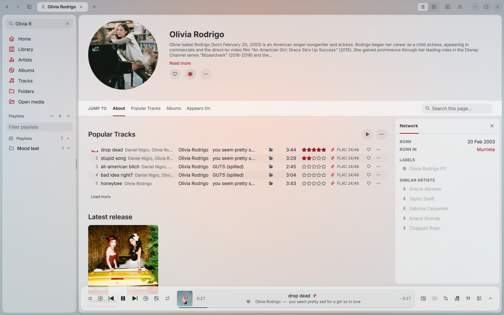
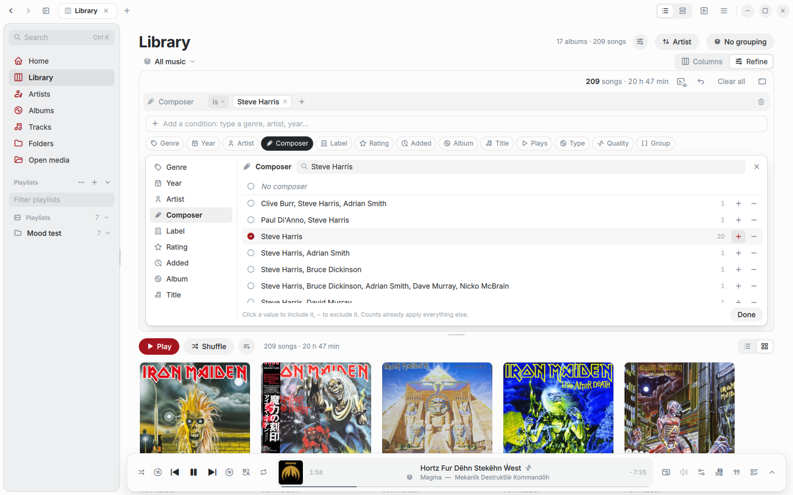
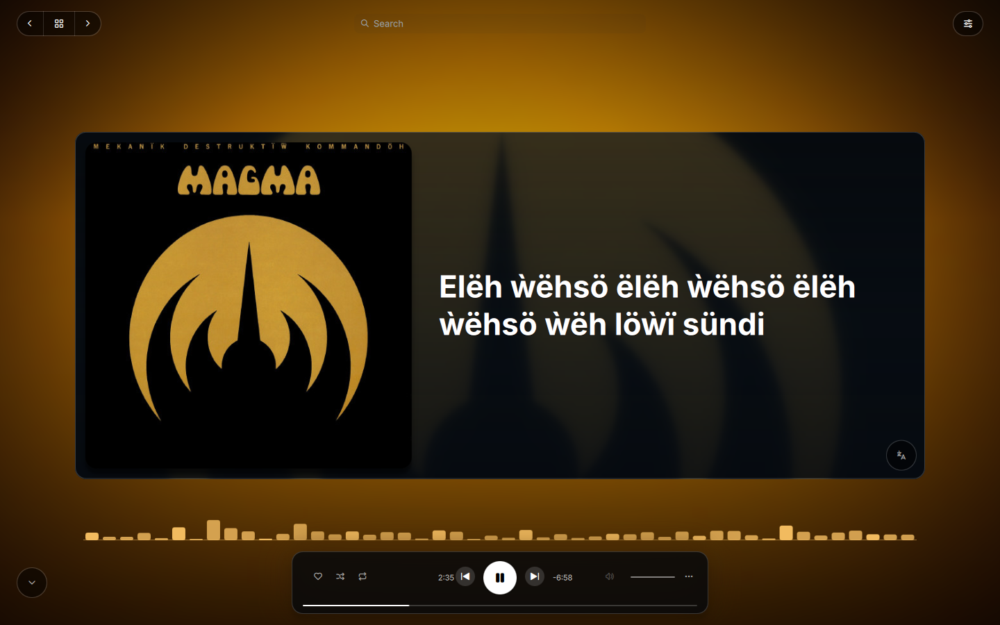
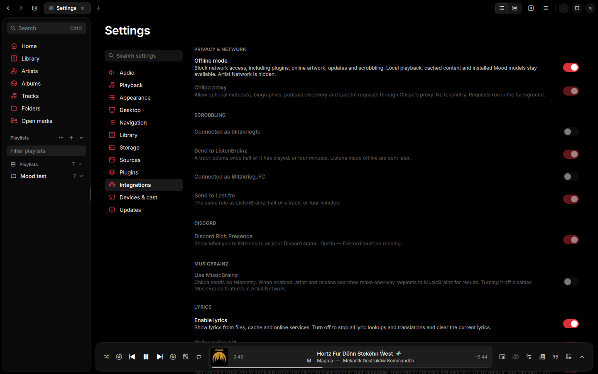

<div align="center">


<p>
  <a href="https://github.com/vicrodh/chilpa/releases"></a>
  <a href="https://github.com/vicrodh/chilpa/actions/workflows/checks.yml"></a>
  <a href="https://github.com/vicrodh/chilpa/releases"></a>
  <a href="https://www.rust-lang.org"></a>
  <a href="https://www.qt.io"></a>
  <a href="https://techforpalestine.org/learn-more"></a>
</p>

</div>

### Chilpa is a Hi-Fi music player. Bit-perfect. Multi Platform. Multi Source

I took the name **Chilpa** from *chilpatl*, a Classical Nahuatl word for a
**red wasp or hornet** (*avispa roja / avispón*).

And yes, it is the spiritual successor of QBZ. 

_Cool, but just take me to the download page_
Sure, here is: [Releases](https://github.com/vicrodh/chilpa/releases)



## Features

- Local music libraries, album editions, CDs and supported disc images.
- All the formats that matters, FLAC, WAV, ALAC, DSD, DFF, and also the others Mp3, ogg, etc; CUE sheets support, SACD images: covered. 
- Multiple queues, playlists, search and source-aware library browsing.
- **Refine**: narrow the library with conditions on artist, genre, year,
  composer, label, rating, quality, source, etc. Save queries, load queries, play with the library, it's yours. 
- **Listening stats**, local only, keep track of listening, visual features like
  listening clock, lapse compare and export to CSV or a PNG image.
- **Self-Hosted-Aware** Compatible with most common self-hosted servers: Jellyfin, Subsonic, Plex, NAS, SMB, etc.
- Audio output that reports its actual format and processing state.
- Synchronized lyrics, translations and immersive views that react to audio.
- **Plugins** add sources and features: radio, podcasts, DSP presets and a
  graphic EQ, playlist import and local mood analysis, from the official
  catalog, the third-party catalog or any other. See [Plugins](#plugins).
- **DAP Sync** Sync DAPs or phones with the music library, track changes, multistorages, multi devices.  
- **A command line**, as if Vim and the Quake console had a child. Press `:`
  to open it. Try it :)
- Configurable **keyboard shortcuts** and keyboard navigation.
- **Multilingual** English, Spanish, German, French, Dutch, Portuguese, Russian and Japanese. Corrections from native speakers are welcome.


## Screenshots

<table>
  <tr>
    <td width="50%">
      <picture>
        <source media="(prefers-color-scheme: dark)" srcset="assets/captures/02_bit-perfect_dark.png" />
        
      </picture>
      Queues, and the route of the current track: DSD256 played natively through ALSA, bit-perfect.
    </td>
    <td width="50%">
      <picture>
        <source media="(prefers-color-scheme: dark)" srcset="assets/captures/03_hifi_wizard_dark.png" />
        
      </picture>
      The HiFi Wizard prepares the PipeWire and WirePlumber files for a DAC. Chilpa never writes them; you review and apply them.
    </td>
  </tr>
  <tr>
    <td width="50%">
      <picture>
        <source media="(prefers-color-scheme: dark)" srcset="assets/captures/04_artist_page_dark.png" />
        
      </picture>
      An artist page: popular tracks with their format, the latest release, labels and similar artists.
    </td>
    <td width="50%">
      <picture>
        <source media="(prefers-color-scheme: dark)" srcset="assets/captures/05_refine_dark.png" />
        
      </picture>
      Refine narrows the library by artist, genre, year, composer, label, rating, quality and more.
      Full size: <a href="assets/captures/05_refine_dark.png">dark</a> · <a href="assets/captures/05_refine_light.png">light</a>.
    </td>
  </tr>
  <tr>
    <td width="50%">
      
      The immersive view with synchronized lyrics.
    </td>
    <td width="50%">
      
      Offline mode blocks every network request; local playback and cached content keep working.
    </td>
  </tr>
</table>

## Install

```sh
curl -fsSL --proto '=https' https://chilpa.app/install.sh | bash
```

Installs or updates Chilpa for your user, on Linux and macOS. If macOS refuses to open the app, run `xattr -dr com.apple.quarantine ~/Applications/Chilpa.app` once.

| Package | Platform | Updates |
| --- | --- | --- |
| AppImage | Linux x86_64, ARM64 | In app |
| Tarball | Linux x86_64, ARM64 | In app |
| macOS app (DMG, ZIP) | Apple Silicon, Intel | In app |
| DEB, RPM | Linux x86_64, ARM64 | Package manager |
| AUR, Gentoo overlay | Linux x86_64, ARM64 | Package manager |

<details>
<summary>Install from a package manager</summary>

```sh
# Debian, Ubuntu
sudo curl -fsSL https://pkgs.chilpa.app/chilpa.gpg -o /usr/share/keyrings/chilpa.gpg
echo 'deb [signed-by=/usr/share/keyrings/chilpa.gpg] https://pkgs.chilpa.app/apt stable main' | sudo tee /etc/apt/sources.list.d/chilpa.list
sudo apt update && sudo apt install chilpa

# Fedora, RHEL
sudo curl -fsSL https://pkgs.chilpa.app/chilpa.repo -o /etc/yum.repos.d/chilpa.repo
sudo dnf install chilpa

# Arch
yay -S chilpa-bin

# Gentoo
eselect repository add chilpa git https://github.com/vicrodh/chilpa-overlay.git
emaint sync -r chilpa
echo 'media-sound/chilpa-bin ~amd64' | sudo tee -a /etc/portage/package.accept_keywords/chilpa
emerge --ask media-sound/chilpa-bin
```

openSUSE, signing key and ARM64 notes: [INSTALL.md](INSTALL.md).

</details>

Every package is on [Releases](https://github.com/vicrodh/chilpa/releases). Commands, requirements, uninstalling and where your data lives: [INSTALL.md](INSTALL.md).

## Plugins

Install them from **Settings > Plugins**: press **Install**, switch the plugin on and approve the permissions it declares.

The [official catalog](https://github.com/vicrodh/chilpa-plugins) is built in and works offline. The [third-party catalog](https://github.com/vicrodh/chilpa-3rd-party-plugins) lists plugins by independent authors, tagged **Third-party**, and its README has the rules. Any other catalog can be added by URL, and **Install from ZIP…** takes a package downloaded by hand.

| Plugin | What it does |
| --- | --- |
| Radio | Stations from Radio Browser. |
| Podcasts | Shows and episodes from PodcastIndex. |
| Chilpa DSP | Equalizer, crossfeed and listening presets. |
| Playlist Importer | Imports public playlists and files, and matches them to your sources. |
| Mood | **Experimental.** Mood and similarity from local audio, with offline models. |

Process plugins run in a sandbox: `bubblewrap` on Linux (unprivileged user namespaces on, not root), Seatbelt on macOS. WASM plugins need nothing extra.

To write one, start with [chilpa-plugins-sdk](https://github.com/vicrodh/chilpa-plugins-sdk), and see the [listing rules](https://github.com/vicrodh/chilpa-3rd-party-plugins/blob/main/CONTRIBUTING.md) for the third-party catalog.

**Agent Skill** I spent the time working on the SDK so you won't have to if you want to develop a plugin. For example, I included a skill in the SDK repository that's compatible with the most popular agents (Claude, Codex, Kimi). As a result, I used the Spotify integration as a proof of concept and ended up with a functional plugin that's fully integrated with Chilpa in 3–4 hours (and a few hundred thousand tokens, to be honest). 

## Privacy and offline use

Chilpa has **no telemetry**: no analytics, usage reports or tracking. Your stats stay on your machine.

Some optional features use online services, in the background and never holding up playback:

- **Chilpa proxy:** metadata, artist biographies, podcast discovery and Last.fm. Off in **Settings > Integrations > Chilpa proxy**.
- **Chilpa lyrics API:** sends track metadata for lyric searches, and the lyric lines for translation. Each has its own switch; **Enable lyrics** stops all lookups.
- **MusicBrainz:** artist relationships and release metadata. Has its own switch.
- **Log upload:** only when you press **Upload (public)**. It posts the diagnostics bundle to bpa.st, a public paste that expires after a week.

**Offline mode** blocks all network access for Chilpa and its plugins. Local playback, DSP, and local or cached artwork and lyrics keep working. Install plugins and download Mood models first.

## Build from source

Rust 1.96 and Qt 6.11 or newer:

```sh
git clone https://github.com/vicrodh/chilpa.git
cd chilpa
cargo build --locked --release -p chilpa-qt
./target/release/chilpa-qt
```

Dependencies for Ubuntu 24.04 and the exact release setup: [BUILDING.md](BUILDING.md).

## AI Disclosure

<strong>Is Chilpa a vibe-coded app?</strong><br />
<strong><u>Yes it is</u></strong>. When I started <a href="https://github.com/vicrodh/qbz">QBZ</a> it was for myself: I built it because there was no Qobuz client for Linux, and although I admire Strawberry a lot (Chilpa takes several of its features as inspiration), I have a love/hate relationship with it, so I didn't want to use the web player and I didn't want to fight with Strawberry's search either. First I made a small CLI client based on the Python downloaders, then I turned it into an API, then I fell for the Rust hype (for the better) and decided to migrate the project to that language, all by hand, as a POC, as a hobby. When LLMs went mainstream I dusted the project off, and that's when it saw the light: over its 9 months of life it became the reference open-source streaming player. Its core was hand-written code; its evolution was vibe-coded.<br />
Chilpa, on the other hand, is 99% vibe-coded: it already had all the logic, the ADRs and, above all, the community's feedback. I have written no more than 200 lines of Chilpa's code, plus several unit tests; being optimistic, that's 1% of the code, and that's rounding up. So yes, Chilpa is a vibe-coded app. It's built responsibly, with good practices, ADRs, SOLID and the workflows I use in my real job.<br />
It is not a weekend project. I could have handed QBZ's code to the agents and had everything ready in a couple of days, but the first release took no less than a month, because everything is written in a modular way and every module was reviewed with unit tests, with Sonar and by a human before being integrated into the app. Even so, for transparency I have to say it: it's still vibe code.<br />
If that's a problem for you, Chilpa is probably not for you.

## Roadmap

I have a clear path to take Chilpa where I want it to be. There is a lot of
work ahead: these are the main tasks, alongside the feedback the community
sends. Please open an [issue](https://github.com/vicrodh/chilpa/issues) for
any bug you find, feature you want or idea you have.

- [ ] A control API, with its documentation
- [ ] Windows release
- [ ] Mood based and dynamic playlists. Based on your local listens, pure vectors, pure math, no AI. 
- [ ] Daemon mode
- [ ] Mobile versions (iOS and Android)
- [ ] Hive mode: control any Chilpa instance from any other
- [ ] Better documentation for the SDK and plugins

## Contributing

Read [CONTRIBUTING.md](CONTRIBUTING.md) before opening a pull request. Report
bugs in [Issues](https://github.com/vicrodh/chilpa/issues) with the Chilpa
version, distribution, audio backend, steps to reproduce and logs with account
data removed. Ideas go to
[Discussions](https://github.com/vicrodh/chilpa/discussions).

## License

MIT; see [LICENSE](LICENSE). Third-party notices are in `licenses/`, and the
distributed packages include the licenses of the bundled Qt and runtime
components. Plugins and optional model downloads keep their own notices.

## Acknowledgements

This software stands on other people's work. Thank you to:

| | |
|---|---|
| <sub>**Platform**</sub> | <sub>[Qt](https://www.qt.io), [cxx-qt](https://github.com/KDAB/cxx-qt), [Rust](https://www.rust-lang.org), [SQLite](https://www.sqlite.org) with [rusqlite](https://github.com/rusqlite/rusqlite), [Wasmtime](https://wasmtime.dev)</sub> |
| <sub>**Audio**</sub> | <sub>[Symphonia](https://github.com/pdeljanov/Symphonia), [lofty](https://github.com/Serial-ATA/lofty-rs), [ebur128](https://github.com/sdroege/ebur128), [souvlaki](https://github.com/Sinono3/souvlaki), [dsd2pcm](https://sourceforge.net/projects/dsd2pcm/) by Sebastian Gesemann, [dst-decoder](https://crates.io/crates/dst-decoder) and the MPEG-4 DST reference authors</sub> |
| <sub>**Look and feel**</sub> | <sub>[Lucide](https://lucide.dev), [Tabler Icons](https://tabler.io/icons), [Inter](https://rsms.me/inter/) by Rasmus Andersson</sub> |
| <sub>**Metadata**</sub> | <sub>[MusicBrainz](https://musicbrainz.org), [Cover Art Archive](https://coverartarchive.org), [ListenBrainz](https://listenbrainz.org), [Last.fm](https://www.last.fm), [Discogs](https://www.discogs.com)</sub> |
| <sub>**Lyrics**</sub> | <sub>[LRCLIB](https://lrclib.net), NetEase Cloud Music, Kugou, QQ Music, [Apple Music-like Lyrics](https://github.com/Steve-xmh/applemusic-like-lyrics)</sub> |
| <sub>**Servers**</sub> | <sub>[Jellyfin](https://jellyfin.org), [Navidrome](https://www.navidrome.org), [Plex](https://www.plex.tv), [Subsonic](http://www.subsonic.org), [Lyrion](https://lyrion.org)</sub> |
| <sub>**QBZ**</sub> | <sub>[QBZ](https://github.com/vicrodh/qbz), for everything it taught me, and above all its community: your feedback, your bug reports and your patience shaped most of what Chilpa is</sub> |
| <sub>**Crates**</sub> | <sub>The authors of every crate in `Cargo.lock`, whose work runs under all of the above</sub> |

### Anti-Acknowledgements

To Konami, for releasing <a href="https://steamcommunity.com/id/blitzfc/achievements/4231820">Castlevania: Belmont's Curse</a>. As Castlevania fan, this took all my attention and delayed the release for two weeks. Sorry, not sorry.
